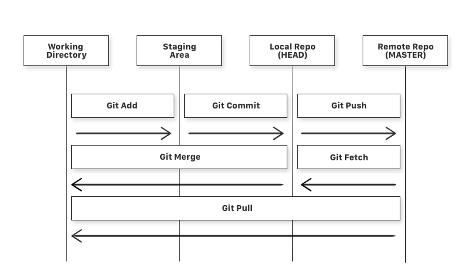

# Git

Git is a program and not a website.
But it makes it possible to use [GitHub][GitHub], ([GitLab][GitLab] and [Bitbucket][Bitbucket])

- **git**: a version control program
- [GitHub][GitHub]:
  Most commonly used website for sharing code. (Now private projects are free too)
- [GitLab][Bitbucket]:
  Similar to GitHub, but looks a bit different. It also 'interprets' MarkDown differently
- [Bitbucket][Bitbucket]:
  It is another alternative to GitHub.

[GitHub]: https://github.com/
[GitLab]: https://gitlab.com/
[Bitbucket]: https://bitbucket.org/

## What is Version Control?

> Version control is a system that records changes to a file or set
> of files over time so that you can recall specific versions later.
> So ideally, we can place any file in the computer on version control.

A Version Control System (VCS) allows you to revert files back to a previous state,
revert the entire project back to a previous state, review changes made over time,
see who last modified something that might be causing a problem, who introduced
an issue and when, and more. Using a VCS also means that if you screw things up or
lose files, you can generally recover easily.

**Main reasons for using git (or version control in general):**

- You can make sure that you can trace back earlier versions (e.g. to reuse the
  awsome paragaph you had written last week, but then the co-authors convinced
  you to delete)
- You can work on multiple platforms and work consistently
- Helpful for working one project by a team

## Git Workflow

A **repository** a.k.a. **repo** is nothing but a collection of source code.

There are four fundamental elements in the Git Workflow:

- Working Directory
- Staging Area
- Local Repository
- Remote Repository



If you consider a file in your Working Directory, it can be in three possible states:

- **It can be staged.** Which means the files with the updated changes are marked
  to be committed to the local repository but not yet committed.
- **It can be modified.** Which means the files with the updated changes are not
  yet stored in the local repository.
- **It can be committed.** Which means that the changes you made to your file are
  safely stored in the local repository.

Commands used in the basic worklfow:

- `git add` is a command used to add a file that is in the working directory to
  the staging area.
- `git commit` is a command used to add all files that are staged to the local repository.
- `git push` is a command used to add all committed files in the local repository
  to the remote repository. So in the remote repository, all files and changes
  will be visible to anyone with access to the remote repository.
- `git fetch` is a command used to get files from the remote repository to
  the local repository but not into the working directory.
- `git merge` is a command used to get the files from the local repository into
  the working directory.
- `git pull` is command used to get files from the remote repository directly
  into the working directory. It is equivalent to a `git fetch` and a `git merge`.

### Getting started

You either start by creating a local repository that you wish to version control
or you start with a remote repository that you want to have on your computer

Starting from scratch

```bash
mkdir my-repo
cd my-repo
echo "# My repo" >README.md
git init
```

Getting remote repository

```bash
git clone https://github.com/git/git-reference
```

## Resources

- [Git Cheat Sheet](https://education.github.com/git-cheat-sheet-education.pdf)
- [Learn the Basics of Git in Under 10 Minutes](https://www.freecodecamp.org/news/learn-the-basics-of-git-in-under-10-minutes-da548267cc91/):
  most of the content on this page is copied from this resource
- [GitHub][GitHub]:
  Most commonly used website for sharing code. (Now private projects are free too)
- [GitLab][Bitbucket]:
  Similar to GitHub, but looks a bit different. It also 'interprets' MarkDown differently
- [Bitbucket][Bitbucket]:
  It is another alternative to GitHub.

## Advanced subject: using submodules

> Need to write why it is good. [Source](https://git.wiki.kernel.org/index.php/GitSubmoduleTutorial)

Go to the location within the repo where you want to place the submodule
(extrnal git repo).

```bash
repo=git@github.com:<account>/<repo>.git
git submodule add $repo
git commit -m 'adding submodule: <account>/<repo>'
git push
git submodule init
```

> Not sure what `git submodule init` exactly does and when you need to use it.

### Update submodule within supermodule

If you want to locally update the content of the submodule and then udpate the
remote of the submodule and the super (root) git.

```bash
submodule=home
cd $submodule
git checkout master
echo "a new file" >my-file.txt
git add my-file.txt
git commit -m "Updated the submodule from within the superproject."
git push
# Submodule is updated. Now onto the supermodule
cd ..
git add $submodule # Here use the name of the folder, but without a trailing '/'
git commit -m "Updated submodule"
git push
```

### Updating the submodule from the remote

```bash
cd $submodule
git pull
cd ..
git add $submodule
git commit -m "Updated submodule: $submodule"
git push
```

## Cleaning things up to match last commit

To revert a folder or file to the last commit version

```bash
git checkout -- $target
# Or you can use HEAD instead of --
git checkout HEAD $target
```

To remove every file and subdirectory not tracked in the current working directory

```bash
git clean -fd .
```

## Firewall issue

At the Westerdijk you can update your `~/.ssh/config`.
With this setting you can clone repose using the SSH link.

```
Host github.com
  Hostname ssh.github.com
  Port 443
```

