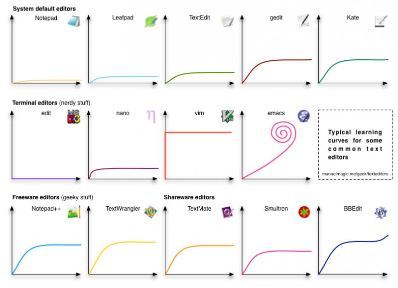
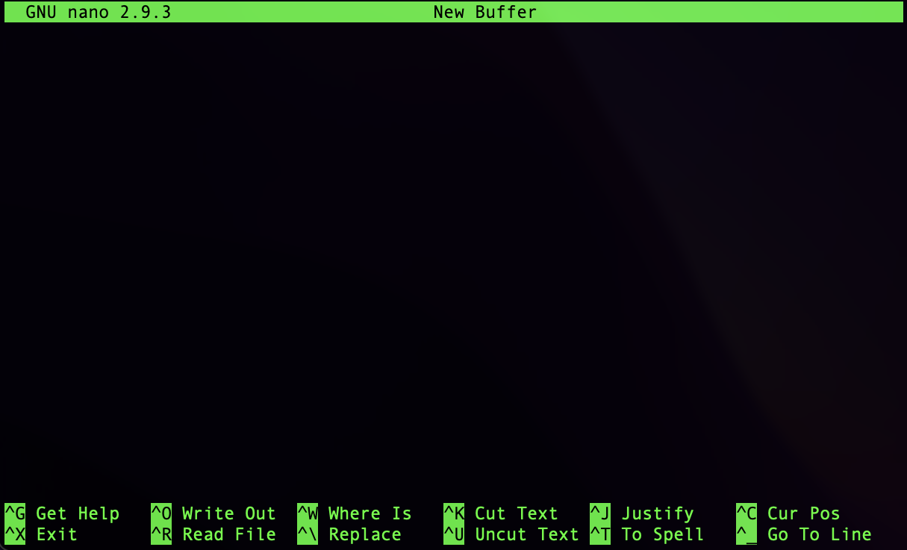
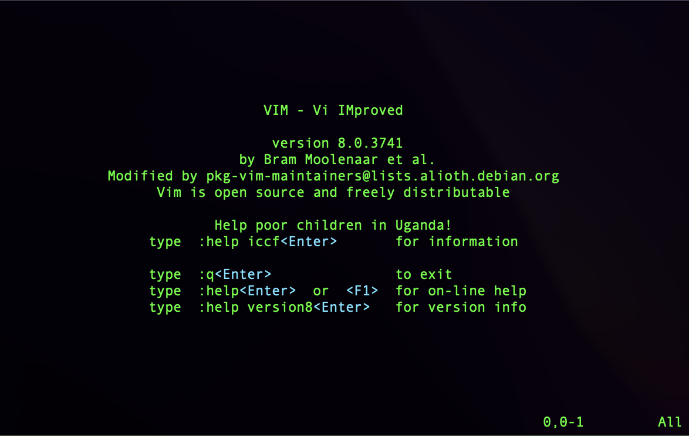
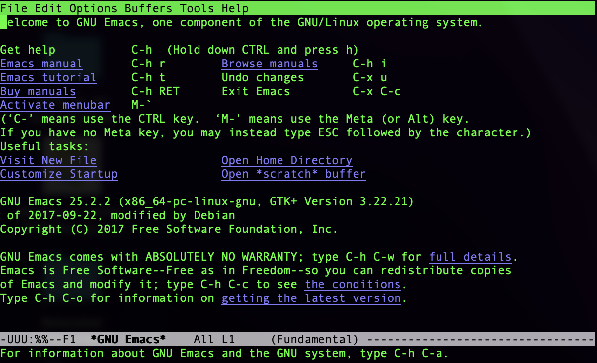

# Text editing

Most of your time goes into reading and editing text
(writting and debugging scripts or workflows, or reading and writing your notes and manuals).
Most people are using MS Word as their go to text editor. There are three things wrong with
Word for bioinformatics or any kind of text not meant for people using Word:

- it does not use a clear text format (if you open it on the command line, you will see gibberish)
- it requires a graphical user interface (which you don't have on the command line)
- it offers no support for any code related work

When working with text we have three big classes (that are not mutually exclusive):

- **Word processors**:
  A word processor is a more advanced type of text editing software used for creating, processing
  and producing (including composition, editing and formatting) any type of printable material.
  Word processors also include features and functions for text formatting (eg. bold, underline,
  italic) and are able to handle structures like tables and areas and other elements like images
  and charts.
    + MS Word
    + LibreOffice Writer
    + OpenOffice Writer
    + (Apple) Pages
- **Text editors**:
  A text editor is another type of software application which is used for creating and editing
  text files (aka plain text files). In contrast to word processing software, text editors are
  based on a simple type of character set like the ASCII system to display and store
  both alphanumeric and symbol characters.
    + Notepad (GUI; Windows)
    + MS Visual Studio (GUI)
    + **Depricated:** _Atom (GUI)_
    + Notepad++ (GUI; Windows)
    + nano (CLI)
    + emacs (CLI)
    + vim (CLI)
    + joe (CLI)
- **IDEs** (**I**ntegrated **D**evelopment **E**nvironment):
  An Integrated Development Environment is a special type of application which contains a lot of
  different functions and features for development software. Typically, an IDE often consists of
  a source code editor, compiling tools and debugging functions. This makes it a complete platform
  for development and programming.
    + PyCharm (Python)
    + RStudio (R)
    + IDLE (Python)
    + **Depricated:** _Atom (through configurations and/or packages)_
    + MS Visual Studio
    + emacs (through configurations and/or packages)
    + vim (through configurations and/or packages)

So when it comes to working on the command line (CLI), then there are three main programs that
you can use:

- nano
    + very easy to get started
    + quite simple to use
    + but does not have some powerful tools that vim and emacs provide
- vim
    + when you start it looks intimidating
    + requires an investment to learn
    + always present on any command line
    + one of the most highly regarded editors
- emacs
    + looks less intimadating than vim
    + more gradual learning curve than vim
    + you can keep deepening and deepening your knowledge and write extensions to it
    + has bigger footprint than vim, and not installed by default on all systems
    + one of the most highly regarded editors

To get an impression on what you can achive and how much effort it takes look at this image:

Also check out the web on the [editor war](https://en.wikipedia.org/wiki/Editor_war): the epic conflict between emacs and vim.

## nano

- Quit: `Ctrl` + `x`

## vim

- Quit: type `:q` then hit enter (you may need to hit `Esc` to be able to issue the command)

## emacs

- Quit: `Ctrl` + `x` `Ctrl` + `c` 

## joe (Joe's Own Editor)

- Quit: `Ctrl` + `k` `q`