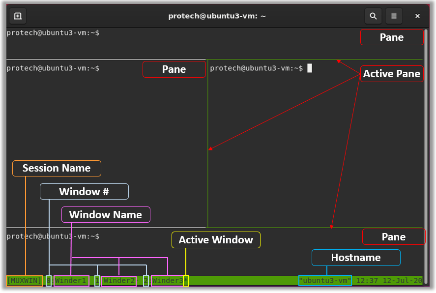

# tmux

tmux is a terminal multiplexer.
It lets you switch easily between several programs in one terminal,
detach them (they keep running in the background) and reattach them to a different terminal.

- [A short guide to tmux](https://peterxjang.com/blog/a-minimalist-guide-to-tmux.html)
- [Cheatsheet](https://tmuxcheatsheet.com/)

## Managing sessions

Start a new session:
```
# start a new session without custom tag
tmux new
# OR start with a custom tag
tmux new -s <tag>
```

Detach session: `Ctrl`+`b` `d`

List available sessions:
```
tmux ls
```
Or during a session: `Ctrl`+`b` `s`

Attach session
```
# Attach the last session
tmux a
# Attach specific session
tmux a -t <tag>
```

## Navigating within a session

Within a session you can have multiple areas where you can work.
This can be handy to do things parallel or to see different
information side by side (e.g. reading a manual and testing
it out in another terminal.)

Similar how it works on a graphical desktop computer you can
have things that occupy the full screen (**window**) and sub parts of the screen (**pane**). Just think of a classical Dutch window with smaller panes.

When you start up a new session than it opens with a single window with a single pane.
Here below can you see how it can look like with multiple windwos and panes.



- createa new window: `Ctrl`+`b` `c`
- switch to next window: `Ctrl`+`b` `n`
- switch to previous window: `Ctrl`+`b` `p`
- horizontal split for new pane: `Ctrl`+`b` `"`
- vertical split for new pane: `Ctrl`+`b` `%`
- Switch between two panes: `Ctrl`+`b` `o` (or `Ctrl`+`b` arrow buttons)
- Make a pane "full screen" or "minimize" to normal size: `Ctrl`+`b` `z`

## Saving session across restarts

Download the plugin to the proper location with the following command:
```
git clone https://github.com/tmux-plugins/tpm ~/.tmux/plugins/tpm
```

Set your `~/.tmux.conf` to the following:
```
# List of plugins
set -g @plugin 'tmux-plugins/tpm'
set -g @plugin 'tmux-plugins/tmux-sensible'

# Other examples:
# set -g @plugin 'github_username/plugin_name'
# set -g @plugin 'github_username/plugin_name#branch'
# set -g @plugin 'git@github.com:user/plugin'
# set -g @plugin 'git@bitbucket.com:user/plugin'
set -g @plugin 'tmux-plugins/tmux-resurrect'
set -g @plugin 'tmux-plugins/tmux-continuum'

set -g @continuum-restore 'on'

# Initialize TMUX plugin manager (keep this line at the very bottom of tmux.conf)
run '~/.tmux/plugins/tpm/tpm'
```

Reload your tmux session:
```
tmux source ~/.tmux.conf
```

Install plugins specified in `~/.tmux.conf`:
Launch a tmux session and type `Ctrl`+`b` `I` (capital i).
If you changed the default **prefix** from `Ctrl`+`b` than use your custom prefix.
