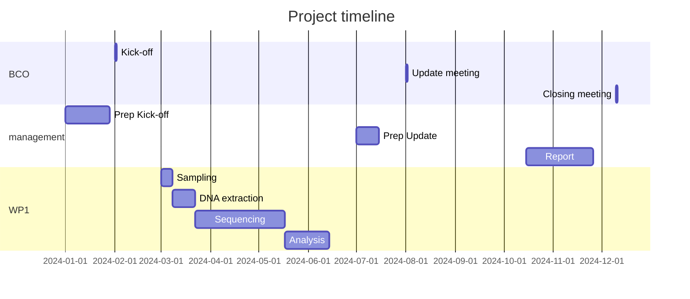

# Project title

## Project info (metadata)

> General administrative information and identifiers

- Title:
- Project code/ID:
- Duration:
- Project leader:

Links:

> Data or metadata stored somewhere else or mention of the project
> (e.g. institute website).

### Description

> What is the goal and approach. General idea about the project.
> Also could mention if there are big experiments or studies involved.

### Planning

> Time line and goals.

Example time line chart:



Goals:

> You can also use lists or text to capture the planning and goals.
> Try to use links to relevant resources (like analysis folders, eLAB experiments, etc.)

## Structure

> This is a general suggestion for structure. Not all parts are relevant to all projects.
> Some parts may fit better as sections in this or another MarkDown. If for example,
> you want to create a results section instead of the folder, then add a new section
> `## Results` and update the above link to `- [results](#results)`.

- [background](#background)
    - Optional to keep beckground information that the project is based on
    - Articles
    - Previous projects
    - Hypotheses that will be tested
- [legal](legal)
    - This is collection of important documents related to the project
    - Grant information
    - Research data management plan
    - Q or GMO documentation
    - Other important legal or operational documents
- [data](data)
    - Preferably store this in Yoda
    - Use gitignore file to exclude from git
- [analysis](analysis)
    - A folder to keep an organized overview different bioinformatic analyses
- [results](results)
    - This can be used to keep a refined overview of the results from the different analyses
- [output](output)
    - This is for presentations, reports, papers and other documents
    - Either containing the files (mostly for clear text formats) or linking to files kept elsewhere
- [tools](tools)
    - Keep all the project specific scripts and other tools that are not managed somewhere else
    - Conda environment.yaml can also be stored here

## Background

> Information on how this project fits with what is known are happening:
>
> - What has already been done by the group or others?
> - What is the theoretical consideration behind the plan?
> - What alternatives are available?

## Documenting analysis

Example template for an analysis/experiment:

```markdown
# Analysis title

> Description of the experiment or analysis.

> The goals of the experiment:
> - goal 1
> - goal 2

## Samples or input

> Describe what is used for the analysis, and its source

## Software environment

> - Describe where the analysis is executed (e.g. server "x", Geneous, CLC workbench, WSL on work desktop, WSL on own laptop).
> - Mention if a conda environment is used (bonus point if you can provide an
>   environment.yaml to reproduce the environment), or other such tool (e.g. docker)
> - Version of the tools used

## Used software

> Which programs are used, and where can they be found (e.g. github)
>
> This section can be combined with the previous one

## Logbook

> Note what was done, and note observations similar to lab experiments.

## Results

> Describe the results and result files (and where are the result files stored).

## Conclusions

> Are there conclusions like recommendations or biological findings?
>
> Note follow ups as well.
>
> Mention what could be improved in the future for similar research questions.
```

## Funding information

> Use this section to not grant and funding information, especially if something is need to be included in
> publications and/or presentations.
