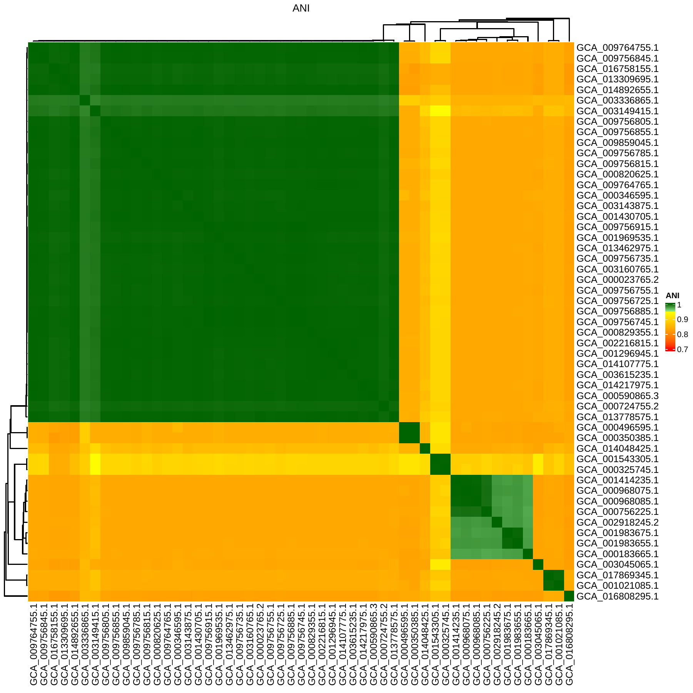
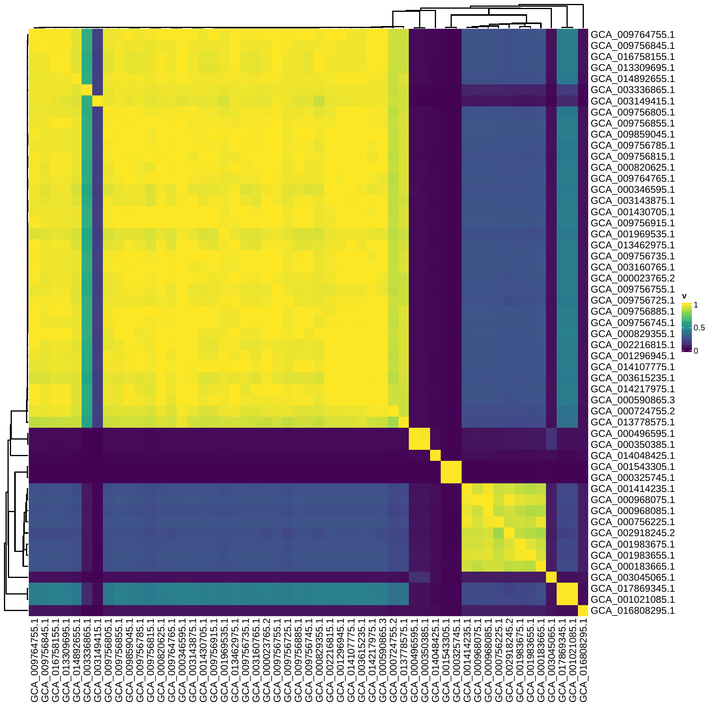
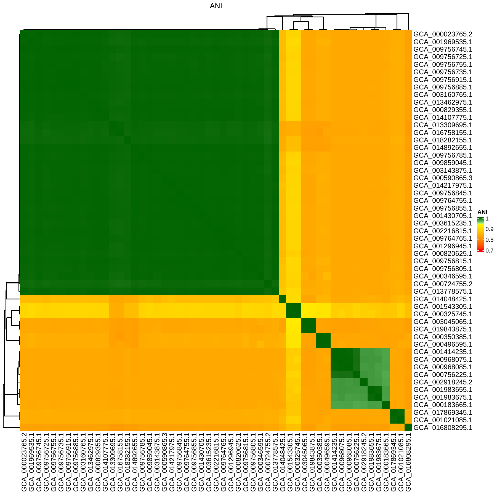
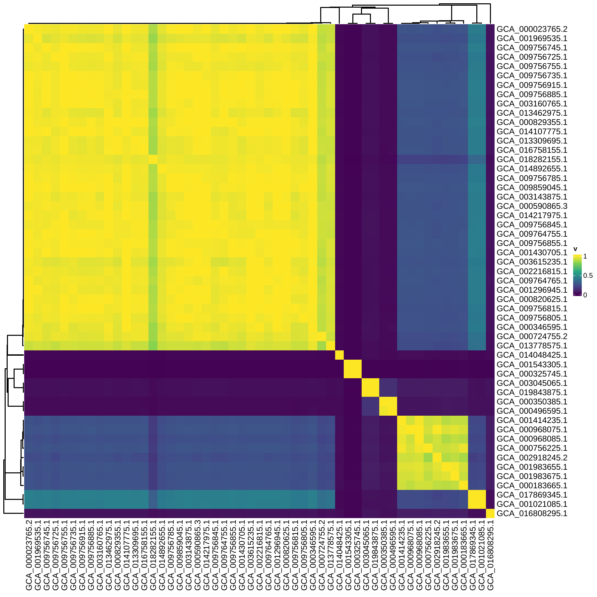

# Exploring genomic data using linux

For this example we use assemblies from NCBI of _Liberibacter_ spp.

## Collect data and metadata from NCBI

The taxonID of _Liberibacter_ is `34019`.
Using the `get-assembly-overview-for-taxon.pl` script we can query the NCBI DB
for all assemblies belonging to this taxon and its subtaxa. The script will
create a tab-delimited file with metadata on the assemblies.

> Available in [https://git.wur.nl/brank001/bioinfo404/](https://git.wur.nl/brank001/bioinfo404/) at `pages/API-sequence-databases/get-assembly-overview-for-taxon.pl`

```
get-assembly-overview-for-taxon.pl 34019 >assembly-metadata.tsv 2>log
```

The first 5 lines of the metadata file will look like this (run on 4th of May 2021):
```
# AssemblyID    TaxID   SpeciesName     Isolate BioSampleAccn   AssemblyName    LastMajorReleaseAccession       LatestAccession FtpPath_GenBank
9788391 34020   Candidatus Liberibacter africanus       Ang37   SAMN15222106    ASM1786934v1    GCF_017869345.1         ftp://ftp.ncbi.nlm.nih.gov/genomes/all/GCA/017/869/345/GCA_017869345.1_ASM1786934v1/GCA_017869345.1_ASM1786934v1_genomic.fna.gz
9220911 2020335 Candidatus Liberibacter ctenarytainae   Oxford  SAMN10841822    ASM1680829v1    GCA_016808295.1         ftp://ftp.ncbi.nlm.nih.gov/genomes/all/GCA/016/808/295/GCA_016808295.1_ASM1680829v1/GCA_016808295.1_ASM1680829v1_genomic.fna.gz
9188681 34021   Candidatus Liberibacter asiaticus       PA20    SAMN13475837    ASM1675815v1    GCF_016758155.1         ftp://ftp.ncbi.nlm.nih.gov/genomes/all/GCA/016/758/155/GCA_016758155.1_ASM1675815v1/GCA_016758155.1_ASM1675815v1_genomic.fna.gz
8248261 34021   Candidatus Liberibacter asiaticus       A-SBCA19        SAMN16263571    ASM1489265v1    GCF_014892655.1         ftp://ftp.ncbi.nlm.nih.gov/genomes/all/GCA/014/892/655/GCA_014892655.1_ASM1489265v1/GCA_014892655.1_ASM1489265v1_genomic.fna.gz
```

It is also interesting to see the last three lines:
```
127911  34021   Candidatus Liberibacter asiaticus       A4      SAMN02665901    A4 genome assembly      GCF_000590865.1 GCF_000590865.3 ftp://ftp.ncbi.nlm.nih.gov/genomes/all/GCA/000/590/865/GCA_000590865.1_A4_genome_assembly/GCA_000590865.1_A4_genome_assembly_genomic.fna.gz
80291   1261131 Candidatus Liberibacter americanus      Sao Paulo       SAMN02604175    ASM49659v1      GCF_000496595.1         ftp://ftp.ncbi.nlm.nih.gov/genomes/all/GCA/000/496/595/GCA_000496595.1_ASM49659v1/GCA_000496595.1_ASM49659v1_genomic.fna.gz
44408   537021  Candidatus Liberibacter asiaticus       psy62   SAMN02603311    ASM2376v1       GCF_000023765.1 GCF_000023765.2
```

All but the last entry have an FTP link which makes it easy to download the assemblies.
But you can notice that `LastMajorReleaseAccession` is not always the same as `LatestAccession`. In many entries `LatestAccession` isn't even defined.
To get the latest version of the assembly we have to select the value from these two columns that is the highest value. For example with the following line:
```
cat assembly-metadata.tsv | cut -f7,8 | perl -ne 's/\R//; ($id) = reverse sort split/\t/; print "$id\n"' >latest
```

With `cut` we select the two columns of interest.
Then custom perl script splits each line by `\t` (tabs) and sorts them
in alphanumeric order that we reverse afterwards, the highest one is printed for each line (also we start by removing line endings at the start, which we add back at the end),
which is saved to `latest`.

> Available in [https://git.wur.nl/brank001/bioinfo404/](https://git.wur.nl/brank001/bioinfo404/) at `pages/API-sequence-databases/generate-new-ftp.pl`

Need to generate new FTP path for the genomes to get the latest possible version based on the metadata:
```
perl generate-new-ftp.pl assembly-metadata.tsv >updated-assembly-metadata.tsv
```

Now we can download all the genomes to a `genomes` folder.
```
mkdir genomes
cd genomes
cut -f10 ../updated-assembly-metadata.tsv | grep -v FtpPath | perl -ne 's/ftp:/rsync:/; s/$/ \./; print "rsync -tLv $_"' | bash >download.log
```

> Previously, I used wget for donwloading. But NCBI recommends using `rsync`.
> For example: `rsync -tLv rsync://ftp.ncbi.nlm.nih.gov/genomes/all/GCA/020/976/085/GCA_020976085.1_ASM2097608v1/GCA_020976085.1_ASM2097608v1_genomic.fna.gz .`

Actually, this list has some duplicates unfortunatelly. This you can see in the `genomes` folder already, there are 2 copies of three genomes.
Besides these there are two more superflous copies that are simply different versions of the same assemblies.
Luckily the extra copies that have older versions were not downloaded, so we only need to clear up the metadata file for consistency.

We can check which entries are missing by doing the following:
```
ls *.gz >got-em
perl -ne ' if (/\t/) {/\/([^\/]+\.gz)/; print unless $got{$1}} else {s/\R+//g; $got{$_}++}' got-em ../updated-assembly-metadata.tsv
# You can get rid off `got-em` so it looks cleaner
rm got-em
# Let's clean up the names to make them a bit shorter, so only the unique sequence ID with version number remains and the extention
rename 's/(\.\d+)_.+genomic/$1/' *.gz
```

Let's unzip them and then move out of the genomes folder
```
gunzip *.gz
ls * >../list
cd ..
```

## Annotate genomes

The default is to use [prokka](https://github.com/tseemann/prokka) to annotate bacterial genomes.

We want to run prokka with some basic settings:
- gram negative bacteria
- define output directory (prokka/ID)
- define a prefix for the output files (use the ID)
- the genus of the strain
```
prokka --gram neg --outdir prokka/GCA_000023765.2 --prefix GCA_000023765.2 --genus Liberibacter genomes/GCA_000023765.2.fna
```

To build the command to run all of them, we can use the following perl script.

> `perl -e` executes the perl commands that are written between the quotes.
> It iterates through all the genome files.
> Store file name as `$file`. Remove folder `genomes/` from the file name and remove the extension. Then print the command using the two variables.

```
cat list | sed 's/\.fna//' | perl -ne 's/\R//g; print "prokka --gram neg --outdir prokka/$_ --prefix $_ --genus Liberibacter genomes/$_\.fna\n"' >prokka.sh
# Or
perl -e 'for(@ARGV){ $file = $_; s/\.fna//; s/genomes\///; print "prokka --gram neg --outdir prokka/$_ --prefix $_ --genus Liberibacter $file\n"}' genomes/*.fna >prokka.sh
```

We can inspect the file before running to make sure that it looks okay. Then run and save the STDOUT and STDERR messages to file.

> This will take a while so run it in the background (Add `&` to the command, then disown using the PID or the relative PID that is printed: e.g. `[1] 10395` can be disowned by `disown %1` or `disown 10395`) or using tmux or screen.

```
bash prokka.sh >prokka.log 2>prokka.err
```

## ANI analysis

> You can find more info and useful scripts at [microbiome/home ANI page](https://git.wur.nl/microbiome/home/-/tree/master/Scripts-and-Workflows/ANI).
> A useful tool is [pyani](https://github.com/widdowquinn/pyani).

Average nucleotide identity (ANI) is a category of computational analysis that can be used to define species boundaries of Archaea and Bacteria.
Calculating ANI usually involves the fragmentation of genome sequences, followed by nucleotide sequence search, alignment, and identity calculation.
ANI is the most widely used method for classifying strains into species.
In order to classify a strain into a species, it has to be fall within the species boundary (which is usually 95–96%).
This is done by calculating the ANI of the type strain and the given strain, if the ANI is higher than the cut-off, then it belongs to the given species.


Let's use [pyani](https://github.com/widdowquinn/pyani) to calculate ANI scores:
```
average_nucleotide_identity.py -i genomes/ -o pyani-out/ -m ANIm
```

In order to visualize the results, we will use the tools from [microbiome/home ANI page](https://git.wur.nl/microbiome/home/-/tree/master/Scripts-and-Workflows/ANI).

```
# Convert ANI scores (TSV) to phylip format distances (d = 1 - ANI)
ani2distance-phylip.pl pyani-out/ANIm_percentage_identity.tab >ani.phy
# Generate a NJ tree from the distance matrix
nj-for-phylip-distance-matrix.pl ani.phy >ani.nwk
# Root the tree by mid-point rooting using nw_tools
nw_reroot ani.nwk >rooted-ani.nwk
# Generate the plot using an Rscript
tree-ANI-heatmap.R rooted-ani.nwk pyani-out/ANIm_percentage_identity.tab  plot.pdf
```



Check coverage information as well. This plot will be asymetric. Values specify the coverage of row ID by column ID.

```
tree-heatmap.R rooted-ani.nwk pyani-out/ANIm_alignment_coverage.tab  cov-plot.pdf
```



You can see that it mostly looks okay and similar to the ANI plot, but there a few oddities.
Especially, GCA_003149415.1 and GCA_003336865.1 look strange. The column and row values are radically different.
Let's look closer by checking the coverage with the typstrain of the group (GCA_000590865.3):

```
table-melt.pl pyani-out/ANIm_alignment_coverage.tab | grep GCA_000590865.3 | grep GCA_003149415.1
table-melt.pl pyani-out/ANIm_alignment_coverage.tab | grep GCA_000590865.3 | grep GCA_003336865.1
```

Now it is clear. The strains are completely coverd by species members, but cover very little of their genomes.
Let's check the genome lengths:

```
fasta_length genomes/GCA_000590865.3.fna 
# Gives 1230251
fasta_length genomes/GCA_003149415.1.fna 
# Gives 233414
fasta_length genomes/GCA_003336865.1.fna
# Gives 769888
```

Okay. That makes it clear what goes wrong. These two genomes are way smaller than the rest.
It is better to exclude them from further analysis.

```
mkdir ignore
mv genomes/GCA_003149415.1.fna ignore/.
mv genomes/GCA_003336865.1.fna ignore/.
mv prokka/GCA_003149415.1 ignore/
mv prokka/GCA_003336865.1 ignore/
cd pyani-out/
mv ANIm_percentage_identity.tab original-ANIm_percentage_identity.tab; table-melt.pl original-ANIm_percentage_identity.tab | grep -v GCA_003149415.1 | grep -v GCA_003336865.1 | table-cast.pl -s >ANIm_percentage_identity.tab
mv ANIm_alignment_coverage.tab original-ANIm_alignment_coverage.tab; table-melt.pl original-ANIm_alignment_coverage.tab | grep -v GCA_003149415.1 | grep -v GCA_003336865.1 | table-cast.pl -s >ANIm_alignment_coverage.tab
cd ..
```

Let's rerun some steps to get new plots for the pruned data set.

```
# Convert ANI scores (TSV) to phylip format distances (d = 1 - ANI)
ani2distance-phylip.pl pyani-out/ANIm_percentage_identity.tab >ani.phy
# Generate a NJ tree from the distance matrix
nj-for-phylip-distance-matrix.pl ani.phy >ani.nwk
# Root the tree by mid-point rooting using nw_tools
nw_reroot ani.nwk >rooted-ani.nwk
# Generate the ANI plot using an Rscript
tree-ANI-heatmap.R rooted-ani.nwk pyani-out/ANIm_percentage_identity.tab  plot.pdf
# Generate the coverage plot
tree-heatmap.R rooted-ani.nwk pyani-out/ANIm_alignment_coverage.tab  cov-plot.pdf
```





Now that we have cleaned up set, let's classify the strains into species using ANI.
First, we need to define the type or reference strains. So far, only one of the
species is officially described, so that is the only one with a type strain.
For the rest we need to assign reference strains, when possible use strains that
are frequently used as reference in studies or used in important comparative studies.

The type file has to have two columns separated by tabs: ID and species name.

```
# True type strain
GCA_000325745.1	Liberibacter crescens
# References doi:10.1371/journal.pone.0171531
GCA_000183665.1	Candidatus Liberibacter solanacearum B
GCA_001021085.1	Candidatus Liberibacter africanus
GCA_000496595.1	Candidatus Liberibacter americanus
GCA_000023765.2	Candidatus Liberibacter asiaticus
# First genomes of a species
GCA_003045065.1	Candidatus Liberibacter europaeus
GCA_016808295.1	Candidatus Liberibacter ctenarytainae
# Haplotypes for solanacearum doi:10.3389/fmicb.2018.02933
GCA_000968085.1	Candidatus Liberibacter solanacearum A
GCA_001983675.1	Candidatus Liberibacter solanacearum C
GCA_002918245.2	Candidatus Liberibacter solanacearum D
# New species doi:10.1128/MRA.00897-20
GCA_014048425.1	Candidatus Liberibacter sp. Z1
```

Now we can classify each strain based on the ANI score using `ani-typer.pl`
from [microbiome/home ANI page](https://git.wur.nl/microbiome/home/-/tree/master/Scripts-and-Workflows/ANI).

```
ani-typer.pl -ani pyani-out/ANIm_percentage_identity.tab -type types.csv | cut -f1,2 | sed 's/solanacearum ./solanacearum/' >species-calls.tsv
```

We keep the first two columns (ID and primary sp. call). We specified multiple reference within _solanacearum_
that will result in all _solanacearum_ strains being classified in all "haplotype species", which is not
what we want at the moment. Using `sed` we also get rid of haplotypes for this file.

> Checking _Ca. L. solanacearum_ strain information at NCBI matches haplotype predictions based on ANI analysis.
> Haplotypes E, F and U are not present in the current set.

## Pangenomics

> - [PanTools](https://git.wur.nl/bioinformatics/pantools)
> - [PanTools manual](http://www.bioinformatics.nl/pangenomics/manual/)
> - [Pangenomics description](../pangenomics/index.md)

We need some files to specify the input for PanTools.
It is handy to create a big overview table, which we can use to generate
the individual input files and to have an overview of PanTool IDs and assembly IDs.

> PanTools labels genomes integer numbers (1, 2, 3, etc.). This does not need to be specified when loading genome sequences, but when adding annotations.

The following script will build our master table based on genome names from the genomes folder.
This will work because we used the same naming convention for prokka, and prokka stores the genome sequence and the annotation at a specific location.
The table has 4 columns: PanTools ID, Assembly ID, genome file (FASTA), annotation file (GFF3).

```
perl -e 'for(@ARGV){$i++; $file = $_; s/\.fna//; s/genomes\///; print join("\t", $i, $_, "prokka/$_/$_\.fna", "prokka/$_/$_\.gff3\n")}' genomes/*.fna >files.tsv
```

The annotation files specified do not yet exist.
The default gff produced using Prokka also contains the FASTA format genome sequnece,
which needs to be removed before using it for PanTools.

```
for i in prokka/*/*.gff; do cat $i | perl -ne 'if (/^##FASTA/) {exit}; print' >$i\3; done
```

Now we will create the two input files for PanTools:

```
# Genome list file for step1
cut -f 3 files.tsv >gf.list
# Annotation list file for step2
cut -f 1,4 files.tsv >af.list
# Pantools ID mapping to NCBI assembly IDs
cut -f1,2 files.tsv >id-map.tsv
```

Then start the PanTools steps.
First build the nuclear pangenome based on the genomes.
Then add the annotation (protein layer).

```
pantools build_pangenome -dp liberi_DB -gf gf.list     >pantools-01.log
pantools add_annotations -dp liberi_DB -af af.list -ca >pantools-02.log
```

Now we want to cluster the proteins.
Since it is not always clear what are the best settings, there is an optimalization option in PanTools.
But for this we need to a BUSCO check first. Since pantools is very particular about the exact version of busco,
we need to start up the pantools conda environment first and then run the busco step.

```
conda activate pantools
pantools busco_protein -dp liberi_DB -if bacteria_odb10 --version busco4 >pantools-03.log
pantools optimal_grouping -dp liberi_DB -if liberi_DB/busco/rhizobiales_odb10 -tn 12 >pantools-04.log
```

```
perl ../pheno-geno-cor/metadata-formats/scripts/get-single-copy.pl liberi_DB/group/35 | grep single-copy | grep -P "\b53\b" >single-copy-in-all.txt
cut -f1 single-copy-in-all.txt >s
perl -ne 'if (/^(\d+):/) {print if $get{$1};} else {s/\R+//; $get{$_}++}'  s liberi_DB/group/35 >single-copy-35.clusters
conda activate pantools
pantools msa_of_group -dp liberi_DB/ -hm s --mode nucleotide,no-trimming∫
```

Aligned sequences in e.g. `liberi_DB/alignments/grouping_v7/groups/653843/output/nuc.fasta`.

> All aligned untrimmed nucleotide sequences `liberi_DB/alignments/grouping_v7/groups/*/output/nuc.fasta`
> Sequnce IDs in the file: `FCIBKHDP_00040_mRNA 1_1_38210_38980` Located on the first chromosome of the first genome at 38210..38980. Object ID=FCIBKHDP_00040

```
# Calculate distance based on alignments
for i in  liberi_DB/alignments/grouping_v7//groups/*/output/nuc.fasta; do cat $i  | fasta_distance >$i\.dist; done
# Calculate barcoding gaps per cluster
for i in  liberi_DB/alignments/grouping_v7//groups/*/output/nuc.fasta; do  perl barcoding-gap.pl species-calls.tsv $i\.dist -id=id-map.tsv >$i\.barcoding; done
# Collect lowest barcoding gap per cluster
for i in liberi_DB/alignments/grouping_v7/groups/*/output/nuc.fasta.barcoding; do echo $i; cat $i | cut -f5 | sort -n | grep -P "\S+" | head -1 ; done >quick
# Negative barcoding gap
less quick | perl -ne 's/\n/\t/ if /liberi/; print' | sort -k2n | grep -c "-"
# Non-negative barcoding gap
less quick | perl -ne 's/\n/\t/ if /liberi/; print' | sort -k2n | grep -c -v "-"
```

There are 204 single copy core clusters (present in all genomes exactly once).
Out of 204, 94 has a positive barcoding gap (\(max(d_{within group})-min(d_{across group})\))

```
perl -ne '$ARGV =~ /groups\/(\d+)\//; print "$1\t$_"' liberi_DB/alignments/grouping_v7/groups/*/output/nuc.fasta.barcoding | grep -v "#" >barcoding-overview.tsv
```

Columns: cluster ID, species, species members count, maximum internal distance, minimum external distance, barcoding gap

76 clusters have a larger barcoding gap than the largest internal distance (for any of the species).

Let's collect these genes for the reference strains.

```
# Get pantoolsIDs for the genomes we want
awk '{print $2 "\t" $1}' id-map.tsv >switch
rename-ids.pl switch types.csv | grep -v '#' >ref-set
# Collect genes of these genomes
perl -ne 'if ($ARGV =~ /groups\/(\d+)\//) {$c = $1; if (/>\S+\s+(\d+)/) {if ($h{$1}) {$get++; $id = $1; s/>/>$c#$id /;} else {$get = undef;}}; print if $get } else {s/\R+//; ($id, $sp) = split /\t/; $h{$id} = $sp;}' ref-set liberi_DB/alignments/grouping_v7/groups/*/output/nuc.fasta | perl -ne 'unless (/>/) {s/-//g; $_ = uc($_)}; print' | fasta_pretty >selection.fas
# Select genes that pass all criteria
perl process.pl barcoding-overview.tsv | grep ok | cut -f1 >cuts-muster
# filter other genes out
perl -ne 'if (/^(\d+)/) {$h{$1}++} else {if (/>(\d+)/) {$get = $h{$1}; }; print if $get;}' cuts-muster selection.fas >final-cut.fas
```

Now we can test our classifying set by mapping this sequences collection against the genomes. The best match for any region should be its own species.

```
nucmer final-cut.fas genomes/GCA_018282155.1.fna --maxmatch
delta2sam.pl out.delta |../pps-standard-diag-ngs/sam-harmonization/sam-keep-best.pl -l | samtools view | cut  -f3 | perl -ne 's/\d+#//; print' | sort | uniq -c
#>     76 1
minimap2 -a -x map-ont genomes/GCA_018282155.1.fna final-cut.fas | samtools view - -F4 -h | sam-flip.pl | sam-keep-best.pl -rid | samtools view | cut -f3 | perl -ne 's/\d+#//; print' | sort | uniq -c

```


> [Tutorial for RAxML](https://cme.h-its.org/exelixis/web/software/raxml/hands_on.html)

```
raxmlHPC -m GTRGAMMA -p 12345  -s single-copy-core.fas -# 20 -n single-copy-core-tree
raxmlHPC -m GTRGAMMA -p 12345 -x 12345 -# 1000 -s single-copy-core.fas -n single-copy-core
raxmlHPC -m GTRGAMMA -p 12345 -f b -t RAxML_bestTree.single-copy-core-tree -z RAxML_bootstrap.single-copy-core -n single-copy-core-final
nw_reroot RAxML_bipartitions.single-copy-core-final | nw_display -  | less
```

